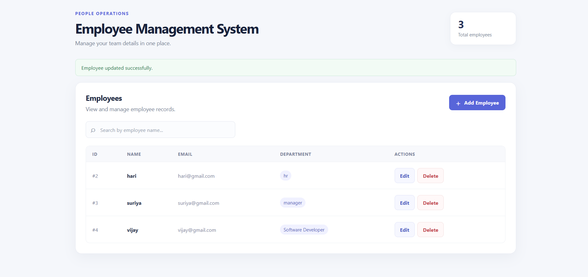
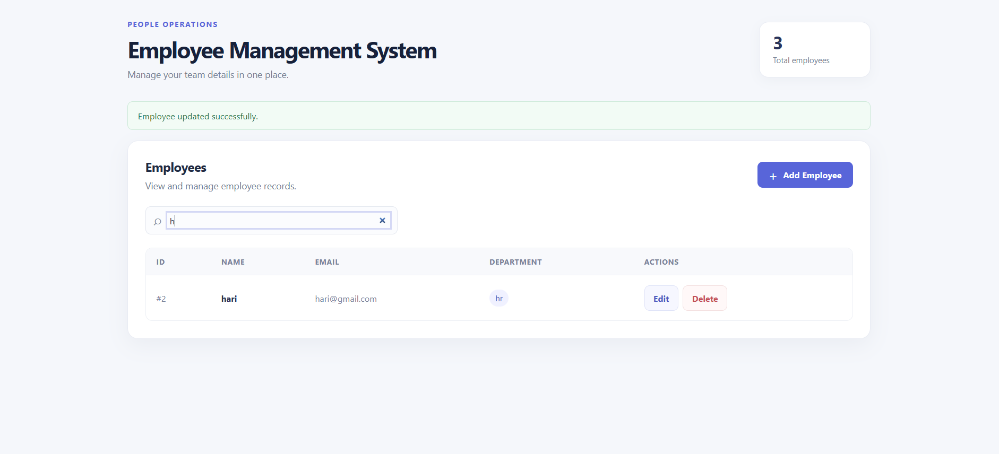
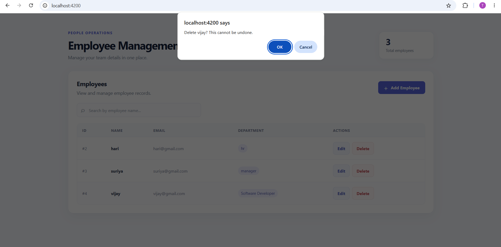
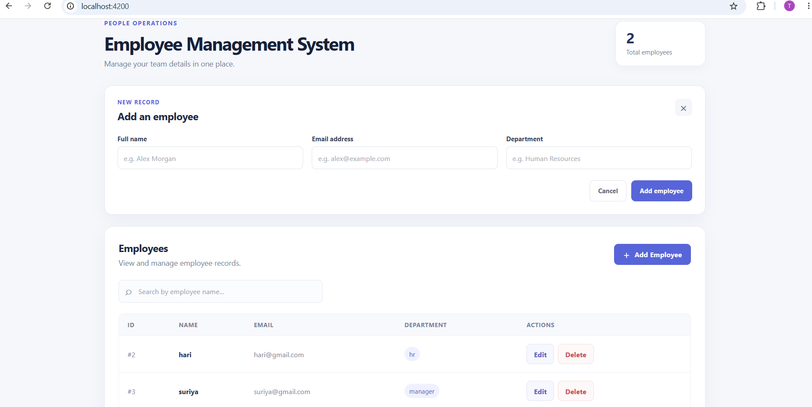

# Employee Management System

## Project Overview

The Employee Management System is a full-stack application for managing employee records. Its Angular 20 frontend communicates with a Node.js and Express.js REST API, which stores employee data in MySQL.

## Key Features

- View the employee list and total employee count.
- Add employees with required-field, minimum name length, and email format validation.
- Search employees by name.
- Edit employee details.
- Delete employees after confirming the action.
- Display loading, empty-list, validation, success, and API error messages.

## Technologies Used

- Angular 20 and TypeScript
- Node.js and Express.js
- MySQL
- HTML5 and CSS3

## Project Folder Structure

```text
shift fills/
├── Backend/
│   ├── config/
│   │   └── db.js
│   ├── controllers/
│   │   └── employeeController.js
│   ├── database/
│   │   └── schema.sql
│   ├── routes/
│   │   └── employeeRoutes.js
│   ├── .env                 # Local credentials; do not commit
│   ├── .env.example         # Safe template with placeholder values
│   ├── .gitignore
│   ├── package.json
│   ├── package-lock.json
│   ├── server.js
│   └── README.md
├── Frontend/
│   ├── src/
│   │   ├── app/
│   │   │   ├── components/
│   │   │   │   ├── employee-form/
│   │   │   │   │   ├── employee-form.ts
│   │   │   │   │   ├── employee-form.html
│   │   │   │   │   ├── employee-form.css
│   │   │   │   │   └── employee-form.spec.ts
│   │   │   │   └── employee-list/
│   │   │   │       ├── employee-list.ts
│   │   │   │       ├── employee-list.html
│   │   │   │       ├── employee-list.css
│   │   │   │       └── employee-list.spec.ts
│   │   │   ├── services/
│   │   │   │   ├── employee.ts
│   │   │   │   └── employee.spec.ts
│   │   │   ├── app.html
│   │   │   ├── app.css
│   │   │   ├── app.config.ts
│   │   │   ├── app.routes.ts
│   │   │   ├── app.ts
│   │   │   └── app.spec.ts
│   │   ├── index.html
│   │   ├── main.ts
│   │   └── styles.css
│   ├── angular.json
│   ├── package.json
│   ├── package-lock.json
│   ├── README.md
│   ├── tsconfig.app.json
│   └── tsconfig.spec.json
├── docs/
│   └── screenshots/
│       ├── employee-dashboard.png
│       ├── employee-form.png
│       ├── employee-list.png
│       └── employee-management-overview.png
└── README.md
```

## Prerequisites

- Node.js and npm (a current Node.js LTS release is recommended).
- MySQL Server and MySQL Workbench.
- A web browser.
- Angular CLI, or use the project-local CLI through `npx`.

## Database Setup

The backend schema is defined in `Backend/database/schema.sql`. Run the following SQL to create the database and employees table:

```sql
CREATE DATABASE IF NOT EXISTS employee_management;

USE employee_management;

CREATE TABLE IF NOT EXISTS employees (
  id INT AUTO_INCREMENT PRIMARY KEY,
  name VARCHAR(100) NOT NULL,
  email VARCHAR(150) NOT NULL UNIQUE,
  department VARCHAR(100) NOT NULL
);
```

To run the script in MySQL Workbench:

1. Start MySQL Server and connect to your local MySQL instance.
2. Open `Backend/database/schema.sql` using **File > Open SQL Script**.
3. Click the lightning-bolt **Execute** button.
4. Refresh the Schemas panel and confirm that `employee_management` and its `employees` table exist.

Each employee must have a name, a unique email address, and a department.

## Backend Setup

Open PowerShell or a terminal in the backend folder and install the dependencies:

```powershell
cd "D:\shift fills\Backend"
npm install
```

Copy the safe template to create your local environment file:

```powershell
Copy-Item .env.example .env
```

Edit `Backend/.env` with your local MySQL connection settings. `Backend/.env.example` contains placeholder values only. This project currently uses MySQL port `3307`; change it if your MySQL server uses a different port. Never commit or share real credentials; `Backend/.gitignore` excludes `.env`.

Start the backend from the `Backend` folder:

```powershell
node server.js
```

The configured npm equivalent is:

```powershell
npm start
```

For development with automatic restarts, run:

```powershell
npm run dev
```

On startup, the backend checks its database connection and then listens at `http://localhost:5000`.

## Frontend Setup

Open a second terminal in the frontend folder and install the dependencies:

```powershell
cd "D:\shift fills\Frontend"
npm install
```

Start Angular:

```powershell
ng serve
```

If Angular CLI is not installed globally, use the project-local CLI:

```powershell
npx ng serve
```

Open the application at [http://localhost:4200](http://localhost:4200). The employee service sends requests to `http://localhost:5000/api/employees`. The backend allows browser requests from `http://localhost:4200`.

## API Endpoints

Base URL: `http://localhost:5000/api/employees`

| Method | Endpoint | Purpose |
| --- | --- | --- |
| GET | `/api/employees` | Retrieve all employees |
| GET | `/api/employees/:id` | Retrieve one employee by ID |
| POST | `/api/employees` | Add an employee |
| PUT | `/api/employees/:id` | Update an employee |
| DELETE | `/api/employees/:id` | Delete an employee |

POST and PUT requests require JSON containing all three fields:

```json
{
  "name": "Alex Morgan",
  "email": "alex@example.com",
  "department": "Operations"
}
```

## Application Testing

1. Start MySQL Server and run the database script.
2. Start the backend and confirm its terminal reports a successful database connection.
3. Start the frontend and open `http://localhost:4200`.
4. Use **Add Employee** to submit a valid name, email, and department. Test blank fields, a one-character name, and an invalid email to check validation.
5. Confirm the new record appears in the table.
6. Type part of an employee's name into the search box and check the filtered results.
7. Select **Edit**, change a value, and save. Confirm the updated details appear.
8. Select **Delete** and confirm the prompt. Verify that the employee is removed.
9. In MySQL Workbench, run:

   ```sql
   USE employee_management;

   SELECT id, name, email, department
   FROM employees
   ORDER BY id;
   ```

   The query shows the employee records currently stored in MySQL.

Run the frontend tests from the `Frontend` folder:

```powershell
npm test -- --watch=false
```

Build the Angular application with:

```powershell
npm run build
```

## Troubleshooting

- **MySQL connection error:** Ensure MySQL Server is running and `DB_HOST`, `DB_PORT`, `DB_USER`, and `DB_PASSWORD` in `Backend/.env` match your local setup.
- **Unknown database:** Run `Backend/database/schema.sql` and ensure `DB_NAME=employee_management`.
- **Incorrect MySQL port:** Check your MySQL server port and update `DB_PORT`. This project's current `.env` uses `3307`; the backend defaults to `3306` if `DB_PORT` is omitted.
- **Backend/API URL error:** Confirm the backend is running on port `5000` and the frontend service uses `http://localhost:5000/api/employees`.
- **CORS error:** Make sure the frontend runs at `http://localhost:4200`, which is the origin allowed by the backend.
- **Email already exists:** The database enforces unique employee emails. Use a different email address when adding an employee.

## Screenshots

### Employee Management Dashboard

[](./docs/screenshots/employee-dashboard.png)

### Employee Form

[](./docs/screenshots/employee-form.png)

### Employee List

[](./docs/screenshots/employee-list.png)

### Employee Management Overview

[](./docs/screenshots/employee-management-overview.png)

## Author

**Name:** Thamizh Selvan R  
**Assessment:** Shift Fills Technical Assessment
